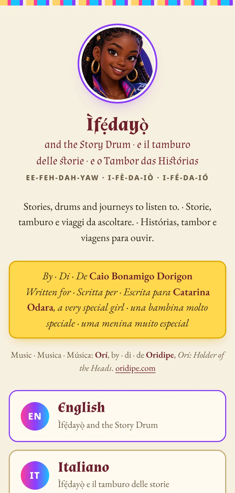
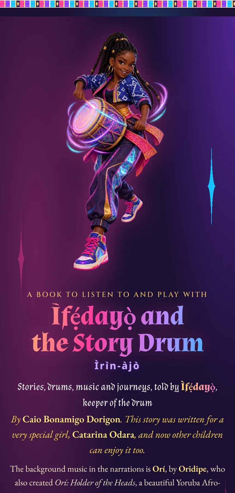
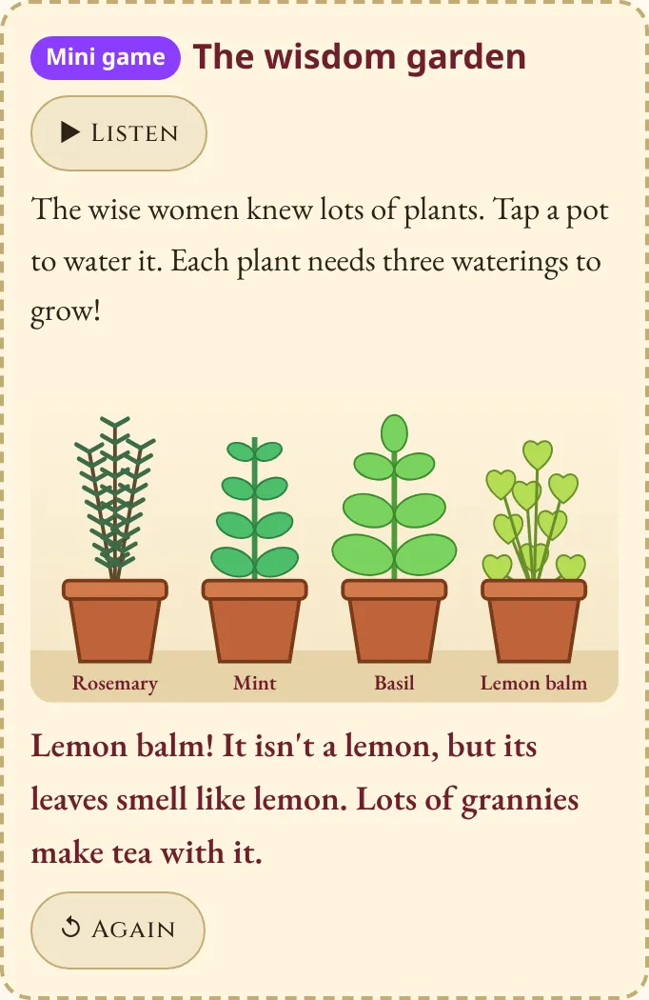
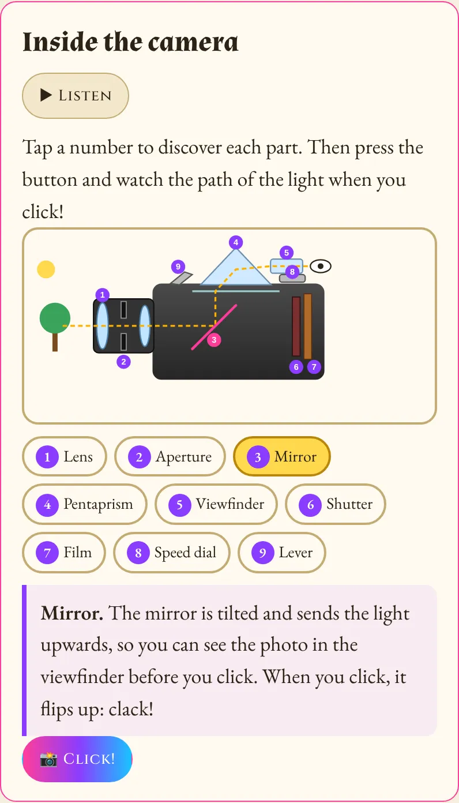

<h1 align="center">Ìfẹ́dayọ̀ and the Story Drum</h1>

<b>A free illustrated audio book for children, in English, Italian and Portuguese.</b> 
Ìfẹ́dayọ̀ e il tamburo delle storie · Ìfẹ́dayọ̀ e o Tambor das Histórias

<a href="https://cdoriga.github.io/ifedayo/"><b>▶ Open the book</b></a> · <a href="https://cdoriga.github.io/ifedayo/en.html">English</a> · <a href="https://cdoriga.github.io/ifedayo/it.html">Italiano</a> · <a href="https://cdoriga.github.io/ifedayo/pt.html">Português</a> · <a href="https://www.paypal.me/cdorigon">💛 Donate</a>

Ìfẹ́dayọ̀ (say it *ee-feh-dah-yaw*) is the keeper of a drum that tells stories. She takes children on a trip through Portugal: the initiation well of Quinta da Regaleira, the Moorish castle and the Pena Palace in Sintra, the watermills of Azenhas do Mar, the walled town of Óbidos and its aqueduct, the giant waves of Nazaré, the rooster of Barcelos, the wind at Cabo da Roca and the wise African women of eighteenth-century Lisbon.

Every story can be read or listened to, with a version for kids and one for grown-ups. Ìfẹ́dayọ̀ narrates all of it, over a soundtrack by the artist Oridipe.

## Why Ìfẹ́dayọ̀

Ìfẹ́dayọ̀ was born in Minas Gerais, in Brazil, and carries a Yoruba name that joins the words for love (*ìfẹ́*) and joy (*ayọ̀*). Her drum is a relative of the dùndún, the Yoruba talking drum, which copies the rising and falling tones of the language. The crest children design uses adire and aso-oke, two Yoruba textiles, and the book tells how the Yoruba, called Nagô in Brazil, crossed the Atlantic together with the peoples of Congo and Angola.

Yoruba culture travelled with enslaved Africans to Brazil, Cuba and beyond, and it lives on in music, food, words and religion. Portugal sat at the centre of that Atlantic trade, so a trip through Portugal is a fitting place to tell children where this culture came from and who carried it. In this book a young Black woman with braids and gold earrings is the guide, the narrator and the one who knows. Children who look like her see themselves holding the knowledge, and every child gets used to learning from her.

The book also gives children words for race and gender. In Lisbon, Ìfẹ́dayọ̀ tells the story of African women healers who were persecuted about three hundred years ago for being Black, African and knowing so much, and she asks children to call out their names so they are remembered. Children meet Joaquina Lapinha, a Black singer born in Brazil who sang opera in Lisbon, and Queen Amina of Zazzau and Queen Nzinga, who ruled and led armies. A detective challenge asks them to look for Black people in old paintings and tiles, and to notice when they are missing. Ìfẹ́dayọ̀ herself has a lisp, and she sings anyway.

These moments sit inside stories about castles, waves and a roasted rooster, at the pace of a bedtime story, so a parent can pause, answer a question and carry on. For families, teachers and librarians, the book is a way into conversations about who gets to be the hero, who was remembered and who was left out.

**The book is free. If it is useful to your family, school or library, please share the link: [cdoriga.github.io/ifedayo](https://cdoriga.github.io/ifedayo/)**

💛 **Support the book:** if you'd like to help me keep making stories like this one, you can donate at [paypal.me/cdorigon](https://www.paypal.me/cdorigon).

## What is inside

- Ten stories with photos of the real places, each narrated in three languages
- Mini games inside the stories: go down the well, turn the watermill, find the words that came from Arabic, a tile memory game, make the rooster crow, paint the palace, sail west, grow a garden of plants
- A drum to play along with Ìfẹ́dayọ̀, music from around the world, princesses from many parts of the world, riddles, a map and curiosity cards
- An illustrated camera that shows how film photography works, with an aperture game
- A personal crest: children type their name and the book becomes a little bit theirs

## Use it like an app, also without internet

The book installs on a phone or tablet with Ìfẹ́dayọ̀'s face as the icon.

- **iPhone and iPad:** open the book in Safari, tap the Share button and choose *Add to Home Screen*.
- **Android:** open it in Chrome and tap *Install app* (or the ⋮ menu, then *Add to Home screen*).

Inside the book, the **📲 App and offline** button downloads the stories and voices of one language (about 75 to 80 MB) so the book also works on a plane or in the car. Use Wi-Fi for that step.

## Credits

**Story, texts and direction:** Caio Bonamigo Dorigon. Written for a very special girl, Catarina Odara, and now for other children too.

**Music:** the background music in the narrations is *Orí*, by **Oridipe**, who also created *Orí: Holder of the Heads*, a Yoruba Afrofantasy comic. See his work at [oridipe.com](https://www.oridipe.com/).

**Voices:** Ìfẹ́dayọ̀'s voice is synthetic, made with open-source text-to-speech models. In English she speaks with the *Chinenye* voice of [YarnGPT2](https://huggingface.co/saheedniyi/YarnGPT2), a Nigerian English model by Saheed Azeez, rendered with [Chatterbox](https://github.com/resemble-ai/chatterbox) by Resemble AI and Coqui XTTS. In Italian and Portuguese she uses Piper voices.

**Photos:** from Flickr, under Creative Commons licences. Thank you to every photographer.

| Place | Photo by | Licence |
|---|---|---|
| Cabo da Roca | [Cahroi](https://www.flickr.com/photos/tevescosta/28301760363/) | [CC BY-SA 2.0](https://creativecommons.org/licenses/by-sa/2.0/) |
| Cabo da Roca | [Cahroi](https://www.flickr.com/photos/tevescosta/28841482101/) | [CC BY-SA 2.0](https://creativecommons.org/licenses/by-sa/2.0/) |
| Cabo da Roca | [Carina Amaral](https://www.flickr.com/photos/7656793@N05/1537105034/) | [CC BY 2.0](https://creativecommons.org/licenses/by/2.0/) |
| Quinta da Regaleira | [Johnny utha](https://www.flickr.com/photos/johnnyutha/2703634338/) | [CC BY 2.0](https://creativecommons.org/licenses/by/2.0/) |
| Quinta da Regaleira | [Jocelyn Erskine-Kellie](https://www.flickr.com/photos/jocelyn777/37262849315/) | [CC BY-SA 2.0](https://creativecommons.org/licenses/by-sa/2.0/) |
| Quinta da Regaleira | [Susanne Nilsson](https://www.flickr.com/photos/infomastern/34340652983/) | [CC BY-SA 2.0](https://creativecommons.org/licenses/by-sa/2.0/) |
| Castelo dos Mouros | [Cahroi](https://www.flickr.com/photos/tevescosta/27528063651/) | [CC BY-SA 2.0](https://creativecommons.org/licenses/by-sa/2.0/) |
| Castelo dos Mouros | [Vitor Oliveira](https://www.flickr.com/photos/vitor107/177569999/) | [CC BY-SA 2.0](https://creativecommons.org/licenses/by-sa/2.0/) |
| Castelo dos Mouros | [Vitor Oliveira](https://www.flickr.com/photos/vitor107/27176438/) | [CC BY-SA 2.0](https://creativecommons.org/licenses/by-sa/2.0/) |
| Palácio da Pena | [Vitor Oliveira](https://www.flickr.com/photos/vitor107/41958320252/) | [CC BY-SA 2.0](https://creativecommons.org/licenses/by-sa/2.0/) |
| Palácio da Pena | [Dale Cruse](https://www.flickr.com/photos/dalecruse/54891386951/) | [CC BY 4.0](https://creativecommons.org/licenses/by/4.0/) |
| Palácio da Pena | [Vitor Oliveira](https://www.flickr.com/photos/vitor107/177580327/) | [CC BY-SA 2.0](https://creativecommons.org/licenses/by-sa/2.0/) |
| Azenhas do Mar | [kweez mcG](https://www.flickr.com/photos/pudstah/4949452110/) | [CC BY 2.0](https://creativecommons.org/licenses/by/2.0/) |
| Azenhas do Mar | [Cahroi](https://www.flickr.com/photos/tevescosta/31952156030/) | [CC BY-SA 2.0](https://creativecommons.org/licenses/by-sa/2.0/) |
| Azenhas do Mar | [Rui Ornelas](https://www.flickr.com/photos/fotos_dos_ornelas/39049043050/) | [CC BY 2.0](https://creativecommons.org/licenses/by/2.0/) |
| Óbidos | [Werner Bayer](https://www.flickr.com/photos/wbayercom/54887916204/) | [CC0](https://creativecommons.org/publicdomain/zero/1.0/) |
| Óbidos | [Werner Bayer](https://www.flickr.com/photos/wbayercom/54887674026/) | [CC0](https://creativecommons.org/publicdomain/zero/1.0/) |
| Óbidos | [Werner Bayer](https://www.flickr.com/photos/wbayercom/54886795662/) | [CC0](https://creativecommons.org/publicdomain/zero/1.0/) |
| Óbidos aqueduct | [Vitor Oliveira](https://www.flickr.com/photos/vitor107/51529615872/) | [CC BY-SA 2.0](https://creativecommons.org/licenses/by-sa/2.0/) |
| Óbidos aqueduct | [Vitor Oliveira](https://www.flickr.com/photos/vitor107/51354514641/) | [CC BY-SA 2.0](https://creativecommons.org/licenses/by-sa/2.0/) |
| Óbidos aqueduct | [Vitor Oliveira](https://www.flickr.com/photos/vitor107/51312115018/) | [CC BY-SA 2.0](https://creativecommons.org/licenses/by-sa/2.0/) |
| Nazaré | [Vitor Oliveira](https://www.flickr.com/photos/vitor107/51633314912/) | [CC BY-SA 2.0](https://creativecommons.org/licenses/by-sa/2.0/) |
| Nazaré | [@Miguel A. García.🎈](https://www.flickr.com/photos/respenda/53455677051/) | [CC BY 2.0](https://creativecommons.org/licenses/by/2.0/) |
| Nazaré | [Werner Bayer](https://www.flickr.com/photos/wbayercom/54887674116/) | [CC0](https://creativecommons.org/publicdomain/zero/1.0/) |
| Lisbon | [Jens Cederskjold](https://www.flickr.com/photos/184898381@N07/48968624576/) | [CC BY-SA 2.0](https://creativecommons.org/licenses/by-sa/2.0/) |
| Lisbon | [madras91](https://www.flickr.com/photos/96579667@N05/47657310091/) | [CC BY 2.0](https://creativecommons.org/licenses/by/2.0/) |
| Lisbon | [Vitor Oliveira](https://www.flickr.com/photos/vitor107/50090680096/) | [CC BY-SA 2.0](https://creativecommons.org/licenses/by-sa/2.0/) |
| Barcelos | [Turismo En Portugal](https://www.flickr.com/photos/turismoenportugal/8064543310/) | [CC BY 2.0](https://creativecommons.org/licenses/by/2.0/) |
| Barcelos | [Florencia&Pe](https://www.flickr.com/photos/boasorteecareca/3254453540/) | [CC BY 2.0](https://creativecommons.org/licenses/by/2.0/) |
| Barcelos | [Halley Oliveira](https://www.flickr.com/photos/halleyoliveira/31685293717/) | [CC BY-SA 2.0](https://creativecommons.org/licenses/by-sa/2.0/) |

## Em português

A Ìfẹ́dayọ̀ nasceu em Minas Gerais e tem um nome iorubá, que junta as palavras amor (*ìfẹ́*) e alegria (*ayọ̀*). O tambor dela é parente do dùndún, o tambor falante iorubá. Neste livro é uma jovem negra quem guia, conta e sabe. As crianças conhecem as mulheres africanas que curavam em Lisboa e foram perseguidas, a cantora Joaquina Lapinha e as rainhas Amina e Nzinga, e recebem um desafio de detetive: procurar pessoas negras nos quadros e azulejos antigos, e perceber quando elas não aparecem. Tudo isso acontece dentro de histórias de castelos, ondas e um galo assado, no ritmo de uma história antes de dormir. O livro é gratuito: compartilhe com famílias, escolas e bibliotecas. Para apoiar: [paypal.me/cdorigon](https://www.paypal.me/cdorigon).

## In italiano

Ìfẹ́dayọ̀ è nata nel Minas Gerais, in Brasile, e ha un nome yoruba che unisce le parole amore (*ìfẹ́*) e gioia (*ayọ̀*). Il suo tamburo è parente del dùndún, il tamburo parlante yoruba. In questo libro è una giovane donna nera a guidare, raccontare e sapere. I bambini incontrano le guaritrici africane perseguitate a Lisbona, la cantante Joaquina Lapinha e le regine Amina e Nzinga, e ricevono una sfida da detective: cercare persone nere nei quadri e negli azulejos antichi, e accorgersi di quando mancano. Tutto succede dentro storie di castelli, onde e un gallo arrosto, al ritmo di una storia della buonanotte. Il libro è gratuito: condividetelo con famiglie, scuole e biblioteche. Per sostenerlo: [paypal.me/cdorigon](https://www.paypal.me/cdorigon).

## Rights

Texts and narration © Caio Bonamigo Dorigon. All rights reserved. You are welcome to read, listen and share the link. The music belongs to Oridipe, and each photo keeps the licence shown above.
